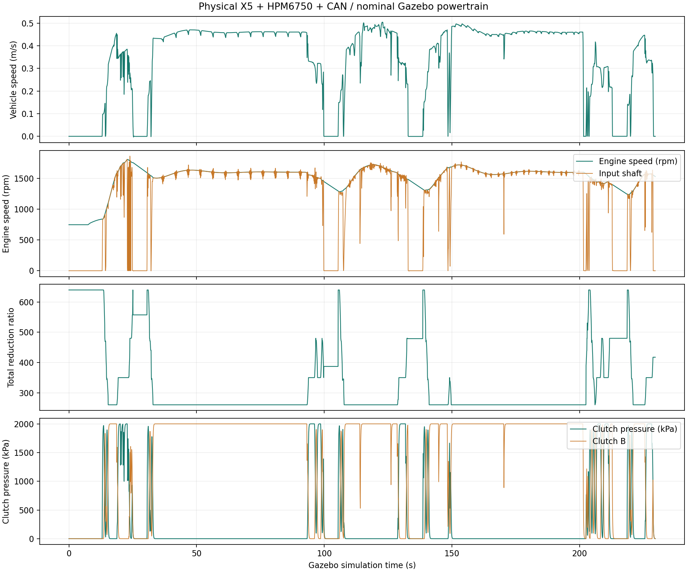
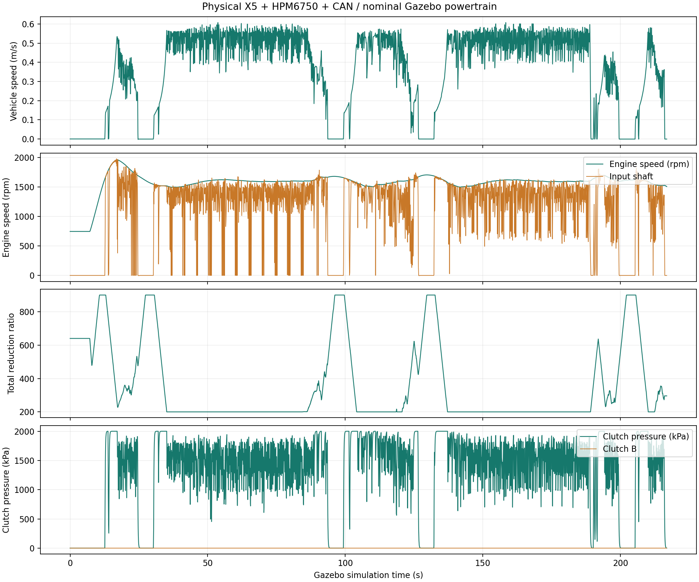
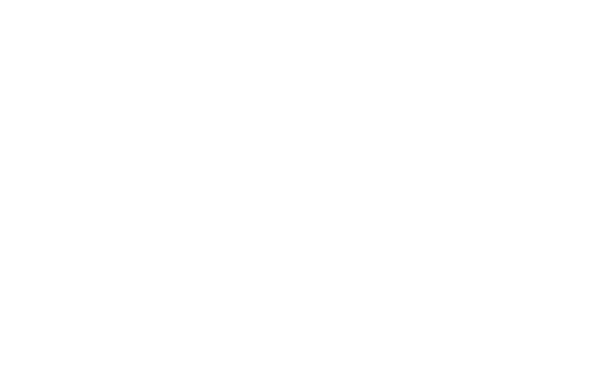

# 动力传动硬件在环测试记录

测试日期：2026年11月11日。对象为新增 Car4 拖拉机、三点悬挂圆盘耙台架的动力换挡及 CVT 扩展。实体链路使用 X5、HPM6750EVK2、两只 USB-CAN 与实际接线，发动机、变速箱、离合器和车辆动力学为 PC Gazebo 等效模型。

结论：最终版本完成16项实体链路检查，动力换挡自动模式和 CVT 自动模式分别完成5阶段作业路线；最终两次全程运行期间未记录到非预期的传动退出或控制器故障，任务结束后撤销运动/作业授权。原阿克曼、差速履带真机协议未修改。

本记录验证应用控制、通信和仿真联动，不作为真实变速箱标定、制动距离、换挡冲击、油耗或 ISOBUS 认证报告。

## 环境与版本

| 项目 | 配置 |
| --- | --- |
| PC | Ubuntu 22.04、ROS 2 Humble、Gazebo Classic 11，原宽地头土壤与场景 |
| X5 | 实际板端计算 NavSat ESKF、Smac Hybrid-A*、MPPI Ackermann 和 STVL |
| 6750 | 悬挂 `0x21` 与传动 `0x22` 控制器同时运行，20 ms 控制周期 |
| 总线 | 两段经典 CAN 均250 kbit/s，上游同线承载台架行走需求和 ISOBUS |
| 接线 | X5 ZQWL 接6750 CAN1，6750 CAN0接PC gs_usb；传感与导航经网口 ROS 2 |
| 隔离 | ROS Domain 74、Gazebo master 11358；禁止与原真机协议混用 |
| 车辆驱动 | 旧后轮速度电机最大转矩为0；新传动模型对后轮施加实际转矩 |
| 默认设置 | 转速请求1600 rpm、交接时间600 ms、CVT变化率150/s |

已烧录 ELF 的 SHA-256：`3337810f52bd2711e1dc0dcbd8d351ac2b626eaba339c98878d8c0f528865113`。`flash-powertrain-01.log` 记录了编程完成及 `Verified OK`。最终 PC 传动插件 SHA-256 为 `32d2d448d7970913e2bd9d680cba91183ffaaff88f3b34d9633dceb68f37f3bd`；X5 ARM 端点为 `2f2fe0bc31e7057884b9c2a71b84b63dcfbed76470f17e0b7e0190d5140181c5`。

烧录前的旧固件、实际板上1 MiB镜像及源代码快照保存在证据根目录的 `pre-extension/`。未更新系统发行版、没有改动实车算法配置。

## 实体功能检查

最终记录：`physical-verification-08/result.json`，`passed=true`，16项全部通过。运行方法、输入参数和前置条件见 [操作说明](POWERTRAIN.md)。检查仅发布 X5 高层指令，由真实6750生成执行量，没有直接写 Gazebo 执行器话题。

| 编号 | 操作 | 实际判据与结果 |
| --- | --- | --- |
| 01 | 核对实体身份和新鲜反馈 | 真实 CAN 植物模型、新传动配置、6750身份及传感反馈就绪，通过 |
| 02 | 手动动力换挡1挡、0.12 m/s需求 | 实际1挡并前进，通过 |
| 03 | 请求4挡及0.45 m/s | 经逐级换挡到实际4挡，车速超过0.34 m/s，通过 |
| 04 | 从4挡请求1挡及低速 | 实际降至1挡并减速，通过 |
| 05 | 行驶中请求切换为 CVT | 收到拒绝结果6，通过 |
| 06 | 显式停车后启用自动 CVT | 模式3并产生实际前进速度，通过 |
| 07 | 提高 CVT 车速需求 | 实际总减速比连续降低、车速提高，通过 |
| 08 | 注入600 N牵引扰动 | 保持模式3、负载反馈600 N，稳定阶段实际车速约0.461 m/s，通过 |
| 09 | 手动 CVT 请求总减速比450 | 实际速比进入450附近并前进，通过 |
| 10 | 手动总减速比改为260 | 实际速比进入260附近并提高车速，通过 |
| 11 | 停止刷新高层传动命令 | 分离驱动、制动、实际车速低于0.03 m/s，通过 |
| 12 | 显式空挡后恢复且降耙 | 传动重新前进，悬挂反馈显示实际接地，通过 |
| 13 | 停车后设置1000 ms交接、50/s速比变化率 | 收到参数设置成功应答，通过 |
| 14 | 手动 CVT 预置总减速比600 | 实际达到600附近，为变化率测量建立初态，通过 |
| 15 | 600向300连续变比 | 2秒观察窗内指令速比平均变化约46.006/s，含传输及采样初始滞后，通过 |
| 16 | 暂挂 PC 原生 CAN 桥、使6750失去传感反馈 | 6750报告超时，撤销驱动并制动，随后停稳，通过 |

第16项分别记录执行与车体响应：本次执行撤销/制动约0.197秒，车速进入0.03 m/s以内约0.301秒。注入期间没有用速度强制归零或修改车辆位置。判据为0.5秒内进入无驱动制动状态，其后5秒内停稳；这是受控实验判据，不是实车响应承诺。测试工具始终在 `finally` 中恢复桥进程，最后清除负载并撤销两项授权。

第13项是协议设置处理应答，第15项是参数作用的实际曲线验证；当前协议没有独立的设置回读 PGN，不能写成完整配置回读校验。

## 完整作业路线

两次均从原起始位置重新启动，使用相同车辆参数、场景及导航配置，所有阶段由 X5 Smac 生成路径，MPPI 跟踪。中间点位置容限0.4 m，最终停车位置容限为前后轴距一半，约1.093 m；不要求最终朝向。

| 阶段 | 动作 | 动力换挡结果 | CVT结果 |
| --- | --- | --- | --- |
| 接近 | 抬耙到作业起点 | 完成 | 完成 |
| 作业行1 | 降耙并行驶约30 m | 完成，1357个实际接地/盘片转动采样 | 完成，1244个实际接地/盘片转动采样 |
| 地头 | 抬耙转弯进入第二作业行 | 完成 | 完成 |
| 作业行2 | 降耙返回约30 m | 完成，1424个实际接地/盘片转动采样 | 完成，1294个实际接地/盘片转动采样 |
| 停车 | 抬耙停车、撤销授权 | 完成，最终位置误差约1.049 m | 完成，最终位置误差约1.038 m |

动力换挡最终记录为 X5 `mission-powershift-03/`；CVT最终记录为 `mission-cvt-02/`。不是只检查了数字挡位变化：整段记录中包含车体真实运动、轮轴响应、离合器压力、实际总减速比、悬挂及盘片状态。

最终源数据审计均 `audit_passed=true`。动力换挡的发动机、速比、车速、负载四类反馈各12,350帧，均可在PC发送的对应原生 CAN 载荷中逐帧匹配。CVT发动机反馈13,832帧，其余三类各13,831帧，也全部匹配。两次运行的任务有效区间均无非预期模式关闭或控制器故障；启动时尚未收到传感的未就绪状态不作为行驶故障。

任务结束后的独立车体记录显示，两种模式的实际车速绝对值均低于0.001 m/s；最终传动使能为0、制动为1。PC/X5墙钟不同，没有用跨机时间戳直接相减推算时延。

## 曲线与软件截图

动力换挡完整路线，包含接近、抬降耙、两条作业行、地头转弯和停车阶段。阶段切换停车与导航降速均保留，不对曲线进行平滑掩盖：

CVT完整路线的实际记录：

参数监视窗口的真实运行截图。顶部为当前状态及请求设置，曲线为最近一段历史，模式切换时当前状态可以已停止而历史曲线仍显示前一阶段行驶：

## 软件回归

| 检查 | 结果 |
| --- | --- |
| 共享C控制器、接地条件与传动闭环 CTest | 3项通过 |
| Python协议、租约、传感组合与新场景合同 | 35项通过 |
| 原悬挂场景合同 | 34项通过，1项新传动专属检查按设计跳过 |
| 原悬挂协议端点回归 | 8项通过，含身份发现、升降、保持、超时、恢复及实车ID隔离 |
| Python语法、Shell语法 | 通过 |

另外保留早期 `gazebo-sil-02` 的12项主机软件在环记录，但最终结论使用上面的真实硬件链路记录，不用主机端点冒充6750实板验证。

## 证据位置与问题闭环

本机证据根目录：`/home/cgz/.local/state/agribot-powertrain-hil-20261111/`。

- `physical-evidence/powershift-final/`：最终动力换挡任务、X5原始CAN、客户端事件、审计和曲线；对应PC为 `physical-pc-07.jsonl`。
- `physical-evidence/cvt-final/`：最终CVT任务、X5原始CAN、客户端事件、审计和曲线；对应PC为 `physical-pc-08.jsonl`。
- `physical-verification-08/`：最终16项检查、实际状态、每次高层发送记录、X5日志、审计和曲线；对应PC为 `physical-pc-09.jsonl`。
- `physical-monitor-*.csv`：只读窗口的实际接收曲线记录。
- `hitch-protocol-regression.json`：原悬挂协议8项回归结果。
- `pre-extension/`、构建与烧录日志：恢复备份及固件校验记录。

早期失败尝试未删除或改写为通过。主要闭环为：监视数据可靠高频发布曾阻塞控制租约，已改为限频最新值；物理遥测改为最新值反馈，减少跨机慢订阅排队；已脱开离合器残压曾被错误纳入有效速比，已按实际传动支路计算并加入回归断言；故障注入检查现在分开记录执行制动和物理停稳，不再将两者混为同一个瞬时判据。

原始构建和大体积逐帧日志留在证据目录，源代码仓库保留操作方法、协议、摘要和由真实记录绘制的图片。后续改动发动机/变速箱参数、车型或地面物理条件后，应重新执行相关检查，不能直接沿用本次性能数值。
