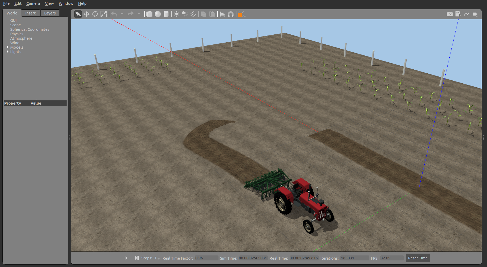

# 拖拉机悬挂控制硬件在环台架

新增动力换挡与 CVT 扩展见 [操作与参数说明](POWERTRAIN.md)、[传动协议](POWERTRAIN_PROTOCOL.md) 和 [测试记录](POWERTRAIN_TEST_REPORT.md)。新传动场景使用独立版本 `0x22`，需要新固件、X5 `powertrain_enabled:=true` 和停用旧后轮速度电机的场景三者配套；原悬挂 `0x21` 及两台真车协议不改。下文未特别说明时仍描述原悬挂台架。

本包为新增的 Car4 轮式拖拉机、后部三点悬挂与圆盘耙测试台架。X5 下发 ISOBUS 应用指令，HPM6750 运行悬挂位置控制器，PC Gazebo 模拟执行器和机械机构。圆盘耙放下、接近土面且车辆在指定农田作业区移动时，原 CAD 的 16 片盘片转动，前后两排盘片翻起土块，后方笼式镇压辊随行进滚动并将土块细碎、整平；抬起或停车后不再新增作业效果。土尘可短暂消散，已形成的耙痕保留。

保留宽地头场景原始土壤模型和贴图，不铺设额外的棕色地板。只有实际耕过的局部区域生成带原土壤贴图的浅层碎土床，不使用不符合圆盘耙的连续高犁垄。两排盘片在实际位置抛出三维不规则土块，短程抛落后停留，经过后辊接触带时分裂为更细的颗粒；后辊后方留下带自然过渡边缘的细碎土层。这是视觉作业效果，不修改地面接触物理网格。车身沿用原 CAD 红色，导出材质使用与漫反射颜色匹配的环境光及低强度高光，避免白色环境光把红漆冲成粉色。

## 独立边界

- 原阿克曼车、差速履带车的真机 CAN 协议、驱动和原植保/粉碎机协议不修改。
- 新增虚拟拖拉机行走报文与悬挂执行/传感报文，不复用原协议的保留字节。
- 两段经典 CAN 均为 250 kbit/s。上游同一条线承载本台架行走标准帧和 ISOBUS 扩展帧。
- HPM CAN1 经外置收发器连接 X5 ZQWL；HPM CAN0 连接 PC gs_usb。原接线保留。
- ISOBUS 端点使用固定的 AgIsoStack++ 提交 `02f3fe910de5fdc73e2014394c2e80900490b9cc`，具备地址声明和对端 NAME 校验，悬挂应用为自定义 PGN，不是 TIM/UT/TC 认证实现。
- `manufacturer_code=2047`、身份 `0xb71/0xb72` 仅为隔离台架身份，不是已分配的生产厂家身份。
- 采用 ROS Domain 74、Gazebo 端口 11358；不得与原 Domain 73、vcan73 测试会话混用。
- 实体为 PC、X5、6750、两只 USB-CAN 和通信接线；液压机构、位置传感器、车辆、GNSS/IMU/雷达及土壤效果为仿真。

## 悬挂控制

位置闭环在 `protocol/hitch_control.c` 中实现，主机软件测试和 `firmware/main.cpp` 使用相同代码。6750 每 20 ms 根据实际位置和速度计算有符号阀控制量。PC 只接收阀控制量，不接收目标高度；等效液压模型以有限关节力矩、阻尼、重力补偿和闭中位保持响应，反馈来自实际 Gazebo 关节。

悬挂使用一个等效举升自由度，配合原模型下拉杆和随真实姿态更新的连接杆。它不是已标定的完整液压/闭链机构。农具不加入导航轮廓和接触碰撞，本台架不验证入土阻力、提升能力、真实药液、真实农艺效果或功能安全等级。

下拉杆连接套筒直接归属实际悬挂运动框架。上拉杆及两侧提升杆由 `linkage_visual.cpp` 优先读取实际渲染运动框架的相对姿态，物理插件发布的姿态作为回退，固定车端连接点、跟随机具端连接点，并使用相互搭接的外套筒、内杆和端部横销。它们不再依赖不断重建车体圆柱体的显示消息，也不使用独立播放的升降动画。

最低作业角度为 `-0.035 rad`，最高抬升角度仍为 `0.4 rad`。机具安装俯仰角补偿 `+0.035 rad`，使最低工作位置的前后两排盘片基本水平，安装基准较原始模型降低8.5厘米，盘片、支架、后辊及连接点共同变换。位置反馈0至10000对应整个实际升降范围，SDF和URDF共用相同限位，不是仅将显示网格向下平移。原生CAN及ISOBUS的报文结构保持不变，不需要重烧6750固件。

后辊由原 CAD 的两半笼体和螺旋条共128个部件组成，单独导出并使用绕真实轴线的转动关节；轴承座和支臂保持固定。后辊转速取自实际车辆纵向速度与滚动半径，悬空时停止驱动。作业历史由服务端保存并周期发布，GUI晚启动或重启后仍能恢复已有耙痕。土块只用于显示，不加入碰撞、导航轮廓或土壤阻力求解。

上电、失联和故障默认停止升降。`HOLD` 是停止流动并保持当前位置，不等于目标位置 0；目标位置 0 是最低作业位置。指令租约为 500 ms，传感反馈有效期为 200 ms；恢复后需要显式中位/保持预热和新指令，不恢复缓存的旧非零动作。PC 执行侧另有 200 ms 的报文新鲜度与序号检查。

## 报文分配

全部私有原生帧长 8 字节，多字节字段小端；最后一字节为 CRC-8/SAE-J1850，前七字节参与校验，初值/异或值均 `0xff`，多项式 `0x1d`。标准校验向量 `123456789` 为 `0x4b`。

| CAN ID | 方向 | 字节 0 至 6 |
| --- | --- | --- |
| `0x620` | X5 经6750至PC | `int16` 速度 mm/s，`int16` 转角 0.1 mrad，使能，版本 `0x21`，序号 |
| `0x621` | PC 经6750至X5 | `int16` 实际速度 mm/s，`int16` 实际转角 0.1 mrad，就绪，故障，序号 |
| `0x630` | 6750至PC | `int16` 阀控量 -1000 至1000，使能，模式，故障，版本 `0x21`，序号 |
| `0x631` | PC至6750 | `uint16` 实际位置0至10000，`int16` 位置变化率单位/s，限位位图，传感故障，序号 |

行走限制为前进 0 至0.5 m/s、前轮转角正负0.61 rad，仅用于本虚拟拖拉机，不是两台真车的协议或性能参数。

| ISOBUS PGN | 用途 |
| --- | --- |
| `0xEF00` | 指定对端的悬挂命令：版本、模式、目标位置低/高字节、速度百分比、序号、使能、CRC |
| `0xFF70` | 实际悬挂传感反馈，保留原生 `0x631` 的载荷 |
| `0xFF71` | 网关和传感就绪状态 |
| `0xFF72` | 应答：版本、结果、模式、命令序号、目标位置低/高字节、保留、CRC |

模式为 0 保持、1 位置控制、2 手动升、3 手动降。限位位图 bit0 为下限、bit1 为上限；同时置位判为非法反馈。重复或倒序报文不刷新有效期。

## 构建与运行

PC 沿用 Ubuntu 22.04、ROS 2 Humble 和项目已有依赖。独立编译不覆盖旧 HIL 安装目录：

```bash
bash src/agribot_hil_hitch/scripts/build.sh --firmware
```

首次生成场景使用 `--prepare`，需要已有 Car4/圆盘耙原模型、Blender 和宽地头场景。输出路径已存在时拒绝覆盖；用 `HITCH_MESH_ROOT`、`HITCH_SCENE_ROOT` 指定新的输出目录。不要把失败的中间目录当作最终交付。

运行前停止原 HIL 会话，核对实体 USB-CAN 序列号并准备总线：

```bash
# PC
sudo bash src/agribot_hil_hitch/scripts/prepare_bus.sh pc
sudo bash src/agribot_hil_hitch/scripts/prepare_network.sh
# X5，本包位于独立工作区
sudo bash ~/agribot_hitch_hil_ws/src/agribot_hil_hitch/scripts/prepare_bus.sh rdk
```

X5 的协议程序单独编译 `protocol`，不需要在 X5 安装 Gazebo。将 PC 生成场景下的 `rdk/` 内容部署到 `~/agribot_hitch_hil_ws/scenario/`，不要修改其中的实车地图或旧定位配置。`run_hil.sh` 使用现有 HIL 的有线 DDS 配置，仅在当前进程内切换为新通信域。

```bash
# PC：HITCH_SCENE_ROOT 指向本次实际生成并核对过的目录
HITCH_SCENE_ROOT=/path/to/scene bash src/agribot_hil_hitch/scripts/run_hil.sh pc \
  can_trace:=/new/path/physical_pc.jsonl
# X5
bash ~/agribot_hitch_hil_ws/src/agribot_hil_hitch/scripts/run_hil.sh rdk \
  can_trace:=/new/path/physical_usb.jsonl client_trace:=/new/path/client.jsonl
```

默认运动和作业均未授权。运行节点身份、定位、CAN 状态和实际位置核对完成后，才在相同 HIL 环境中人工授权。`/hil_hitch/command` 为高层悬挂命令，`/hil_hitch/actuator/*` 只能由真实 CAN 接收桥发布，禁止直接向执行器话题发送运动指令绕过台架。

```json
{"mode":"position","position":9000,"speed":60}
```

高层指令需要持续刷新；终止时发送保持、撤销两项授权，确认实际车速及升降速度归零，再停进程。关闭 Gazebo 窗口不替代停止任务。

## 验证分层

1. `protocol` 的 CTest 验证控制器与接地条件；`test/test_wire.py` 验证私有报文、CRC、租约和分配边界。
2. `verify_isobus_loop.py` 在两个主机端点间运行真实协议栈，为软件在环测试，不是实板证据。
3. `verify_gazebo_sil.py` 使用 vcan74/vcan75 和主机端点检查实际关节升降、16片盘片转动、接地判定及停止；`--gui` 保存真实软件截图。
4. 实体 HIL 必须用真实 X5、6750 和两只 USB-CAN重新执行，并保存两侧原始报文与独立 Gazebo 运动记录。软件侧通过不代替此步骤。

软件在环专用的 `sil_gateway.py` 不能进入实体 HIL 启动链路。预定实体用例涵盖上升、下降、位置设定、多位置切换、保持、上下限、指令超时、反馈失效与行走联动；完成记录后才标记通过。

### 实体检查与自动作业

PC/X5 两端启动并就绪后，在 PC 的新终端执行独立实体检查。它仅向 X5 的高层指令话题和授权服务发送请求，不直接控制 Gazebo 执行器：

```bash
bash src/agribot_hil_hitch/scripts/run_hil.sh pc verify \
  --output /new/path/physical-stationary.json
```

自动作业任务在 X5 上运行，采用已有的 NavSat ESKF、Smac Hybrid-A*、MPPI Ackermann 和 STVL。PC 提供仿真 GNSS/IMU/雷达，X5 计算定位、路径及速度，再经过真实 USB-CAN、6750 到达仿真执行器；悬挂阀控闭环仍在 6750 上。禁止同时执行检查与作业任务。

```bash
# X5，两端服务已运行；--start 是显式运动授权
bash ~/agribot_hitch_hil_ws/src/agribot_hil_hitch/scripts/run_hil.sh rdk mission \
  --output ~/agribot_hitch_hil_ws/mission-new --start
```

任务依次为：抬耙接近作业起点、降耙完成第一条作业行、抬耙地头转弯、降耙完成第二条作业行、抬耙停车。所有行驶路径由 X5 Smac 生成，MPPI 跟踪，不用 PC 的简单直线控制器替代。每段保存原始规划结果、定位/真实位置及关节记录；两条作业行还必须记录到实际接地和盘片转动才算通过。最终位置容限沿用前后轴距的一半，中间作业点使用独立的 0.4 m 位置容限，不要求最终朝向。任务结束或异常时撤销两项授权。

输出目录和原始 CAN 日志要求不存在，避免覆盖旧证据。失败记录应保留，不能仅凭后续截图将失败尝试改成通过。

## 固件与恢复

新固件为独立 `firmware` 工程；不要用它替换两台真车使用的通用固件配置。烧录前保存当前板上镜像及配置区，撤销授权并停止 PC/X5 台架进程，再用 OpenOCD 对 `demo.elf` 执行编程与校验。维护期间对端暂停应答会使 SocketCAN 发送队列耗尽，台架按故障保护退出；烧录完成后应重新启动，不能把维护中断算作一次正常全程运行。SDK 的 `demo.bin` 起始加载地址与全闪存备份不同，不能把二者当作同一地址的镜像混刷。

回到旧植保、粉碎机或阿克曼台架时，必须恢复对应原固件、波特率和启动配置。不能仅切换场景，或只修改波特率后继续使用新固件。

## 本机验证记录（2026-11-11）

原始证据根目录为 `~/.local/state/agribot-hitch-hil-20261111/`，不是全部提交到 Git 的构建或测试缓存。

| 层级 | 记录 | 范围与结果 |
| --- | --- | --- |
| 控制与接地条件 | `build-protocol/` CTest | 2项通过；共享 C 控制器、CRC、限位、超时、重放、恢复与时钟/序号回绕 |
| Python与场景合同 | `test_wire.py`、`test_scene_contract.py` | 18项通过；含独立协议、无整块土层、原土贴图、红漆、套筒归属及加深后的限位映射 |
| 协议端点SIL | `isobus-late-join-03.json` | 8项通过；包含晚启动端点身份发现 |
| 最新显示与物理SIL | `gazebo-sil-07/result.json` | 加深位置后9项通过，包含升降、16片盘片、入土/扬土/耙痕、抬起停止作业及正常退出 |
| 实体闭环 | `physical-stationary-03.json` | 最新套筒显示、实体X5、6750和两只USB-CAN，10项通过；首版记录01也保留 |
| 实体全程作业 | `physical-evidence-02/mission/result.json` | 5阶段全部完成，原土场景、两条作业行、抬耙地头转弯与停车；不是主机端点SIL |
| 实体加深位置 | `physical-depth-01.json` | 加深后真实CAN闭环到达最低作业位置，盘片最低点约在原土面下8至9厘米；已转保持并撤销授权 |

`physical-evidence-02/summary.json` 对真实记录做载荷核对：16268条X5收到的ISOBUS位置反馈均可在PC发送的原生位置报文中找到对应载荷，16196条PC收到的行走报文均可对应X5发出的原生行走载荷。没有以PC/X5不同的墙钟时间推算端到端时延。上套筒最新显示修正另外经过 `gazebo-sil-06` 升降/行走检查；不把显示检查当作新增的真实液压性能验证。

上述原悬挂验证对应 `scene-09/`、`meshes-04/`。当前两阶段翻土显示与动力传动使用 `~/.local/state/agribot-harrow-visual-20261111/scenario-two-stage-01/` 和同目录的 `meshes-two-stage/`。`scene-05`含已撤回的整块棕色覆盖层，不能再作为当前展示场景。失败的初始化尝试及人工中断记录均保留，未改写成通过。

### 两阶段翻土与 CVT 复测

以下记录均位于 `~/.local/state/agribot-harrow-visual-20261111/`。`work-cvt-01.json` 记录到全部16片盘片低于原土面，采样入土约8.4至11.9厘米，后辊峰值角速度约2.02 rad/s，服务端保留作业历史。检查程序 `scripts/verify_harrow_work.py` 只读取状态、盘片最低点、后辊关节速度和 Gazebo 作业历史，不下发执行器指令。

`physical-cvt-visual-01/mission/result.json` 为实际 X5、6750 和两只 USB-CAN 参与的 CVT 自动模式全程记录，接近、第一作业行、抬升转弯、第二作业行、停车5阶段全部完成。`audit.json` 核对4类传动传感反馈共63381条，均可在 PC 原生 CAN 载荷中匹配，未出现非预期切回关闭模式，结束时速度约0.00021 m/s，传动退出使能并制动。发动机、离合器和传动机构仍为等效仿真模型，不代表实物 CVT 性能认证。

后续增强只调整碎土床显示：表面起伏约4至35毫米，局部土粒峰值不超过54毫米，新土色更深、碎土更密，保留自然边缘过渡，不改变底盘、规划参数、入土深度、固件或 CAN 协议。对应预览任务为 `mission-harrow-cvt-02`。自动检查为 Python 37项、CTest 4项通过。



若本机预览会话已由临时用户服务运行，可分别停止：

```bash
# PC
systemctl --user stop agribot-hitch-pc-preview.service
# X5
systemctl --user stop agribot-hitch-rdk-preview.service
```

这些是本次会话的临时服务，不是系统开机自动行走任务。启动后仍默认撤销运动及作业授权，测试完成后也撤销授权；不要把预览状态当作仍在执行作业。
